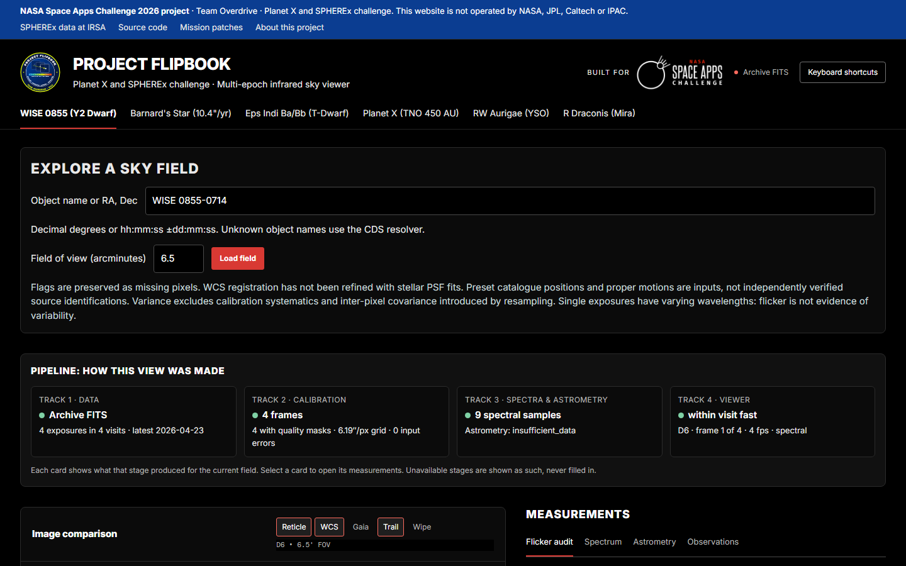
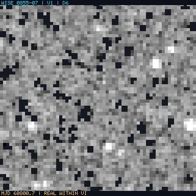

# SPHEREx Sky Flipbook

A NASA Space Apps project for inspecting SPHEREx infrared observations without confusing wavelength changes with temporal variability. Real FITS data and simulations are separate, explicitly labelled sources.





[](https://render.com/deploy?repo=https://github.com/shantanu-research/spherex-planet-x)

## Run

Requires Python 3.12+, Node.js for the frontend check, and FFmpeg for MP4 export.

```bash
python -m venv .venv
source .venv/bin/activate
pip install -r backend/requirements.txt
python scripts/download_observations.py
python -m backend.server 8080
```

Open http://localhost:8080. On Windows activate `.venv\Scripts\Activate.ps1` instead. The downloader installs 42 project FITS files (about 220 MB) and verifies their sizes and SHA-256 hashes. `--target wise_0855` downloads one preset. Set `SPHEREX_DATA_DIR` to use another observation directory.

The default is Barnard's Star, D1. Select another preset to inspect individual observations; choose Visit Blink or Wavelength Match for wavelength-controlled comparisons. Unavailable coverage produces an explanation. **Simulation must be selected explicitly**; it is never a substitute for failed real-data requests.

## Implemented

- Object-name resolution through CDS Sesame, decimal or sexagesimal coordinates, five real-data presets, and a hypothetical simulated target.
- Local project FITS ingestion and bounded IRSA archive discovery, release deduplication, visit grouping, downloaded-cutout caching.
- QR2/QR3 quality flags, zodiacal-model subtraction, celestial and spectral WCS, north-up/east-left registration, and propagated marginal variance.
- Per-pixel wavelength-bin balancing, longest baseline, leave-one-out differences, catalogue-motion tracking, shift-and-stack, D6/D3/D1 false colour, matched-wavelength pairs, and individual-exposure playback.
- Native-pixel aperture flux measurements with errors and observation dates; CSV export and an accessible data table.
- Live Gaia and CatWISE reference overlays, mask display, pan/zoom, wipe comparison, playback and keyboard controls.
- Dataset 'data as of' date, labelled reference band positions on spectra (not detections), and a volunteer 'Flag something interesting' button that saves a local JSON note (nothing is uploaded).
- A pipeline strip showing, for the current field, what each of the four tracks produced (data and visits, calibration and masks, spectra and astrometry, viewer state); unavailable stages are reported as unavailable and each card opens its measurements tab.
- Shareable URL state, iframe embed code, GIF and real H.264 MP4 exports with observation telemetry.
- Docker/Render configuration and GitHub Actions checks.

## Scientific interpretation

The supplied inputs contain 42 files; 41 have usable pixels in the default fields. `docs/validation.json` records every target's coverage, measured aperture results, input errors and mode availability. Regenerate it with `python scripts/validate_observations.py` after downloading inputs.

| Target | Usable exposures, all detectors | Visits, all detectors |
| --- | ---: | ---: |
| Barnard's Star | 6 | 1 |
| WISE 0855-0714 | 9 | 4 |
| Epsilon Indi Ba/Bb | 15 | 3 |
| RW Aurigae | 8 | 3 |
| R Draconis | 3 | 2 |

Visit counts do **not** imply matching wavelengths or multiple epochs for every detector. Barnard's Star has masked/saturated aperture cores. Missing common wavelength bins remain masked; the app never manufactures extra epochs, 102-channel observations, molecular detections, or a confirmed Planet X discovery.

Balancing uses 256 logarithmic wavelength bins from 0.7–5.3 µm, inverse-variance weights within a bin, then equal weights across bins shared by visits. This is a finite-bin approximation, not exact passband matching. Differences use an inverse-variance leave-one-out reference and include reference variance. WCS alignment is not refined through stellar PSF fitting, and PSFs are not homogenized. Resampling introduces covariance not included in marginal error maps. Aperture fluxes have no PSF aperture correction; background and statistical errors exclude calibration systematics.

Tracking uses supplied catalogue proper motion without annual parallax. Preset coordinates are project inputs, not independently verified identifications. Centroid fits, when possible, are exploratory and can be biased by blends and PSF changes. CatWISE overlays retain catalogue-epoch positions. A real-data still-star flicker audit, independent astrometric validation and scientific discovery claims remain unestablished. Simulated statistics are not observational evidence.

## API

All endpoints are GET. `q` accepts a preset, coordinate pair or object name. Frame/export requests also accept `ra` and `dec` separately.

| Endpoint | Purpose |
| --- | --- |
| `/api/health` | Process health; does not claim archive availability |
| `/api/targets` | Presets and installed FITS availability |
| `/api/resolve?q=12,-20&epoch=2026` | Coordinates and linear catalogue propagation |
| `/api/observations?q=RW%20Aur&fov=6.5` | Actual visits and detectors |
| `/api/frames?q=RW%20Aur&det=D3&mode=within_visit_fast` | Frames, masks, measurements and provenance |
| `/api/spectrum?q=RW%20Aur` | Observed aperture samples |
| `/api/overlay/catalogs?q=RW%20Aur&mjd=61000&fov=6.5` | Gaia/CatWISE references and query errors |
| `/api/validation` | Reproducible supplied-data report |
| `/api/export/gif` and `/api/export/mp4` | Animation with the same selected rendering controls |

Frame/export controls: `source=real|auto|simulated`, `det=D1` through `D6`, `fov=1` through `15` arcminutes, `frame_mode=inertial|comoving`, `color_mode=grayscale|spectral|multiband`, `stretch=asinh|sqrt|log`. Modes: `visit_blink`, `longest_baseline`, `difference_sequence`, `motion_tracked`, `spectral_color`, `wavelength_matched`, `within_visit_fast`, `shift_stack`. Individual-exposure mode plays available exposures chronologically, including across visits; its flicker is not evidence of variability. Archive and catalogue services can time out; errors are surfaced without synthetic fallback.

## Verification

```bash
python -m pytest tests backend/tests/test_offline.py -q
node tests/test_frontend.cjs
python scripts/validate_observations.py
```

Real-FITS integration tests skip explicitly when the optional download is absent. Array-level tests cover shared-channel weighting, uncertainty propagation, masks, orientation, tracking and all real rendering modes. Browser checks cover desktop/mobile layout and controls. Synthetic seeds are stable across Python processes.

## Deploy

```bash
docker build -t spherex-flipbook .
docker run --rm -p 8080:8080 spherex-flipbook
```

The image downloads and verifies project observations during its build and installs FFmpeg. Import this repository into Render as a Blueprint using `render.yaml`; `/api/health` is the readiness endpoint. Live requests need outbound HTTPS and a writable cache. No secret is required for public astronomical archives.

Free-tier note: Render's free plan has limited RAM and sleeps when idle; the first request after sleeping is slow. Open `/api/health` to warm it before a demo.

**Publication status:** the backend is running in the development workspace, not at a verified public production URL. A hosting-account connection is still required. GitHub Pages creation was denied by the current integration (HTTP 403); Pages also cannot run this Python backend. Do not describe the application as publicly deployed until a hosting deployment succeeds.

## Who built what

Team Overdrive (NASA Space Apps 2026, Pune local event). Roles follow the team's track plan.

- **Track 1, data pipeline and backend: Malhar Tamhankar.** IRSA archive queries, visit grouping, per-visit frame selection, cutouts and caching, the FastAPI backend; demo-target pre-caching, faster cached search, retry handling for archive 503 errors, same-wavelength time-lapse and the first real SPHEREx light curves.
- **Track 2, image processing: Akhilesh Rohit Bhosale.** Band-balanced stacking (wavelength labels from the spectral WCS, shared-band checks, alignment before stacking) and the colour-shift solution that keeps wavelength changes from being mistaken for motion.
- **Track 3, spectra and science validation: Amrita Patil.** On-the-fly aperture spectra, sub-pixel centroid and proper-motion tracking, Gaia DR3 overlays propagated to each epoch, flag masking and saturation guard, and validation of the five test targets.
- **Track 4, frame stitching, viewer and demo: Shantanu Pawar.** Frame sequencing and viewing modes, the web viewer, GIF/MP4 export, shareable and embeddable URLs, demo and submission.

## Submission and sources

[Project description](docs/submission/project.md) · [Demo script](docs/submission/demo-script.md) · [Recorded walkthrough](docs/demo/walkthrough.mp4) · [Validation report](docs/validation.json) · [Input manifest](data/observation-manifest.json)

Data: [NASA SPHEREx / IRSA](https://irsa.ipac.caltech.edu/Missions/spherex.html), [project Drive](https://drive.google.com/drive/folders/1nfJhjfiqrYmYPUiqscdLWCcKW8jsEbXE), [Gaia](https://gea.esac.esa.int/archive/), [CatWISE](https://irsa.ipac.caltech.edu/Missions/catwise.html), [CDS Sesame](https://cds.unistra.fr/cgi-bin/Sesame).

Software: Astropy, NumPy, SciPy, HTTPX, Pillow and FFmpeg. Web accessibility follows [Chrome Modern Web Guidance](https://github.com/GoogleChrome/modern-web-guidance), including semantic tables, native dialogs/progress and visible keyboard focus. AI assistance was used for implementation, review, tests and documentation. Verify team attribution and competition requirements before submitting.
